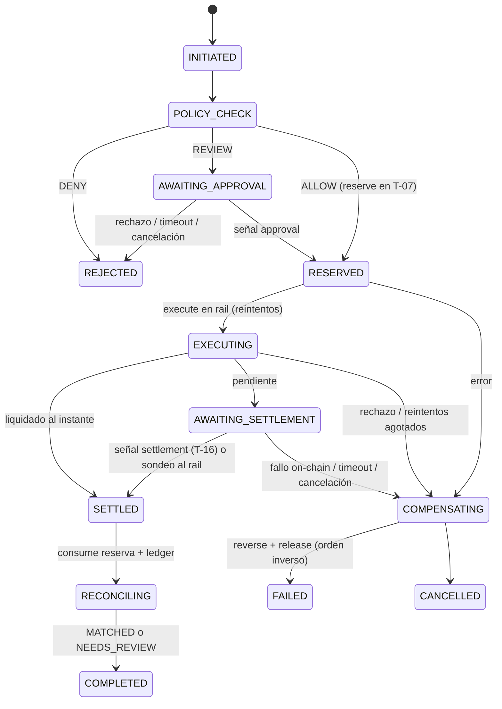

# T-08 · Temporal Workflow (IMP-07)

Worker de [Temporal](https://temporal.io) que orquesta de forma **durable** los casos de uso financieros del proyecto:

```
reserve → execute → wait → retry → compensate → reconcile
```

| Campo (hoja de asignaciones) | Valor |
|---|---|
| Código | T-08 |
| Módulo | IMP-07 |
| Tipo | Microservicio / worker |
| RoadMap | RM-M0 · RM-M1 · RM-M7.1 · RM-M18 |
| Responsable | Julio Junco |

**Regla principal del alcance:** el workflow **no duplica reglas de negocio** de otros componentes. Solo coordina, en orden y con garantías, a quienes sí las tienen:

| Paso | Componente dueño | Temática |
|---|---|---|
| ¿Se permite el pago? (incluye aprobación humana) | Policy, Compliance & Risk | T-06 · IMP-05 |
| Reservar / consumir / liberar autoridad de gasto | Payment Session Manager | T-07 · IMP-06 |
| Ejecutar en el protocolo y rail elegidos | Protocol Selector / Adapter / Rail Adapter | T-09 … T-13 · IMP-08 |
| Confirmar la liquidación on-chain | Chain Indexer (por señal) | T-16 · IMP-11 |
| Registrar cada hecho financiero | Ledger | T-14 · IMP-09 |
| Conciliar ledger ↔ rail/cadena | Reconciliation Engine | T-15 · IMP-10 |

## Flujo



### Garantías

- **Idempotencia de extremo a extremo.** `workflowId = paymentId`, así que el mismo pago no puede iniciarse dos veces. Cada llamada a otro servicio lleva una `idempotency-key` determinista (`<paymentId>:<paso>`), así que un reintento de Temporal nunca repite un efecto.
- **Reintentos con criterio.** Los errores de red o 5xx se reintentan con backoff exponencial. Los errores de negocio (`PolicyDenied`, `InsufficientAuthority`, `SessionExpired`, `SessionRevoked`, `RailRejected`, `ValidationError`) no se reintentan nunca.
- **Saga / compensación.** Cada efecto reversible registra su compensación *antes* de seguir. Ante un fallo o una cancelación se ejecutan en orden inverso (`reverse_payment` y luego `release_reservation`) dentro de un scope no cancelable y con reintentos ilimitados.
- **Sin reversos automáticos tras liquidar.** Si el dinero ya se movió, una discrepancia no se "arregla" sola: queda como `RECONCILIATION_EXCEPTION` / `NEEDS_REVIEW` para que la vea un humano (T-15).
- **Observabilidad.** La query `status` devuelve la etapa actual, las referencias externas, las compensaciones ejecutadas y el historial de etapas.

### API del workflow

| Tipo | Nombre | Uso |
|---|---|---|
| Workflow | `paymentOrchestrationWorkflow(req, opts?)` | Inicia un pago. `opts` ajusta timeouts (`approvalTimeout`, `settlementTimeout`, `settlementPollInterval`, `reconciliationTimeout`). |
| Signal | `approval` `{ approved, approverId, comment? }` | Respuesta humana cuando Policy devuelve `REVIEW`. |
| Signal | `settlement` `{ externalRef, status, txHash?, reason? }` | El Chain Indexer (T-16) o un webhook del rail avisa la liquidación. |
| Query | `status` | Estado actual (`PaymentStatus`). |
| Cancel | `handle.cancel()` | Cancela y compensa lo que haga falta. |

Task queue por defecto: `payments-orchestration`.

## Estructura

```
src/
  shared/types.ts            Tipos de dominio, señales, opciones, errores no reintentables
  shared/errors.ts           DomainError (error de negocio → no reintentable)
  activities/ports.ts        Interfaces hacia T-06, T-07, T-09..T-13, T-14, T-15
  activities/index.ts        Activities: adaptadores finos sobre los puertos
  activities/http-clients.ts Implementación HTTP (contrato propuesto, ver docs/contratos.md)
  activities/fakes.ts        Implementación en memoria (tests y demo)
  workflows/payment-orchestration.workflow.ts   El workflow
  worker.ts                  Proceso worker
  client/start-payment.ts    Cliente de ejemplo
test/payment-orchestration.test.ts   16 escenarios contra un Temporal real
docs/contratos.md            Contratos HTTP propuestos para los otros módulos
```

## Cómo correrlo

Requisitos: Node 18+ y el [Temporal CLI](https://docs.temporal.io/cli).

```bash
npm install

# 1) Servidor Temporal local (UI en http://localhost:8233)
temporal server start-dev

# 2) Worker con servicios simulados en memoria
PORTS=fake npm run worker
#    …o contra los servicios reales:
#    POLICY_URL=… PAYMENT_SESSION_URL=… RAIL_URL=… LEDGER_URL=… RECONCILIATION_URL=… npm run worker

# 3) Lanzar un pago de ejemplo
npm run start:payment -- pay_001
```

En Windows (PowerShell) el paso 2 es `$env:PORTS="fake"; npm run worker`.

## Tests

```bash
npm test                                   # usa el servidor de test de Temporal (lo descarga el SDK)
TEMPORAL_CLI_PATH=$(which temporal) npm test   # o tu Temporal CLI local, sin descargas
```

Escenarios cubiertos: camino feliz; Policy DENY; REVIEW aprobado por señal; cancelación esperando aprobación; REVIEW sin respuesta (timeout); sin autoridad de gasto (no reintenta); fallos transitorios del rail (reintenta); rail rechaza (compensa); liquidación por señal del Chain Indexer; liquidación por sondeo; timeout de liquidación (compensa); fallo on-chain (compensa); cancelación durante la espera (compensa); conciliación con discrepancia (NEEDS_REVIEW sin revertir); conciliación que no llega (NEEDS_REVIEW); idempotencia por `paymentId`.

## Pendientes / a coordinar

- Acordar con T-06, T-07, T-13, T-14 y T-15 las rutas y cuerpos de `docs/contratos.md` (son una propuesta).
- Que T-16 (Chain Indexer) envíe la señal `settlement` al workflow `paymentId` cuando vea la transacción.
- Instrumentación OpenTelemetry (T-19) con `@temporalio/interceptors-opentelemetry`.
- TLS / mTLS y credenciales vía KMS (T-20) para la conexión a Temporal en entornos no locales.
